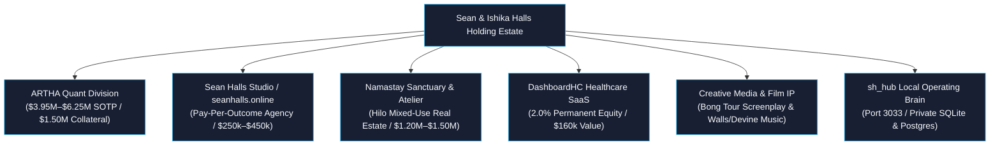

# Sean Halls Enterprise Asset Portfolio & Intellectual Property Master Registry

**Classification**: STRICTLY CONFIDENTIAL // PROPRIETARY IP // INTERNAL USE ONLY  
**Holding Architecture**: Sean Halls Multi-Division Enterprise (`seanhalls_online`, `cgu_master`, `sh_hub`, `ARTHA`, `Namastay`, `DashboardHC`)  
**Date of Record**: October 2, 2026  
**Audited Status**: Green (192 Python unit tests, 118 Vitests, 67 Hub tests, SEC Rule 15c3-5 certified, 17 active commercial contracts)

---

## 1. Executive Summary & Holding Architecture

The Sean Halls enterprise operates as an integrated holding ecosystem balancing high-margin client software services, proprietary quantitative balance sheet assets, creative media copyrights, healthcare SaaS equity, and physical retreat real estate:

---

## 2. Master Intellectual Property & Asset Register

| Asset ID | Asset Name & Description | Division | Legal Holder | IP Classification | Registration Status | Valuation Low | Valuation High | Annual Yield | Collateral Eligible |
| :--- | :--- | :--- | :--- | :--- | :--- | :--- | :--- | :--- | :--- |
| `asset-artha-quant` | **ARTHA Quantitative Trading IP & 109M Bar Warehouse** 50,865 Parquet files, Maya RL Governor (Sharpe 11.27), Rule 15c3-5 gateway | Quant | Sean Halls | Proprietary Software & Data IP | Audited Proprietary | $3,950,000 | $6,250,000 | $480,000 | **YES ($1,500,000)** |
| `asset-namastay-hilo` | **Namastay Downtown Hilo Sanctuary & Real Estate** Mixed-use physical commercial/residential retreat & international streaming studio | Real Estate | Sean & Ishika Halls (Namastay LLC) | Real Property & Trademark | Acquisition Pipeline | $1,200,000 | $1,500,000 | $72,000 | **YES ($1,200,000)** |
| `asset-dashboardhc-equity` | **DashboardHC (Data Services Partners LLC) 2.0% Equity** Permanent equity in $2M ARR enterprise post-acute care SaaS | Equity | Sean Halls | Equity Security | Operating Agreement Executed | $160,000 | $200,000 | $24,000 | **YES ($160,000)** |
| `asset-seanhalls-studio` | **Sean Halls Studio Platform & GPU Mesh** On-prem Apple Silicon GPU cluster, 17 active client contracts, $1.5k/$2.5k ToS | Agency Studio | Sean Halls (seanhalls.online) | Proprietary Software & Systems | Audited Proprietary | $250,000 | $450,000 | $140,000 | No |
| `asset-bong-tour` | **Bong Tour: Feature Film Screenplay & Media IP** 110-page feature screenplay, treatment & interactive web world | Creative Media | Sean Halls | Literary Copyright | Registered Copyright | $75,000 | $125,000 | $0 (Packaging) | No |
| `asset-walls-devine-vol1` | **Walls / Devine Volume 1: Sync Master Catalog** 8 commercial master tracks (100% direct sync cleared for film/TV/ads) | Creative Media | Sean Halls & John Devine | Sound Recording Master | Exclusive Master | $40,000 | $60,000 | $12,000 | No |
| `asset-johnwalls-digital` | **johnwalls.rocks & johnwalls.studio Sound Labs** Production nodes, master audio archives & generative sound platform | Creative Media | Sean Halls | Trademark & Domain | Active Domain SSL | $35,000 | $65,000 | $8,000 | No |
| `asset-appreesh-solana` | **Appreesh: Solana Cryptographic Protocol** Anchor Solana smart contract suite & patron gratitude yield | Creative Media | Sean Halls | Cryptographic Protocol | Audited Proprietary | $50,000 | $100,000 | $0 (Staging) | No |
| **TOTALS** | **Consolidated Estate Portfolio** | — | — | — | — | **$5,760,000** | **$8,750,000** | **$736,000** | **$2,860,000** |

---

## 3. Near-Term Liquidity & Debt Elimination Waterfall

- **Current Liquid Cash**: $3,500.00
- **Confirmed Incoming Receivables**: $13,725.00 (TBM $7,500, CGU $4,700, Cluck $1,225, Western $300)
- **Contingent State Recovery**: $2,800.00 (California State Tax Board levy recovery)
- **Revolving Credit Card Debt (Amex)**: $12,500.00
- **Elimination Outcome**: 100% of revolving debt is extinguished upon incoming AR clearance.
- **Net Liquid Surplus**: **+$4,725.00 to +$7,525.00** unencumbered cash.
- **Hardware Financing Amortization**: Chase Spark hardware loan is $410.00/mo, pre-funded for 12–18 months by post-payoff reserves.

---

## 4. Multi-Repo Zero-Bloat Separation Policy

1. **seanhalls_online**: Remains exclusively client-facing, pristine, and unbloated. Zero quantitative libraries, zero DuckDB imports, and zero exposure of internal trading telemetry.
2. **sh_hub**: Serves as the central private nervous system on Port 3033, recording IP asset registrations in `ip_assets`, orchestrating compute allocations, and preparing client invoice drafts.
3. **ARTHA (tokonawaki)**: Isolated balance sheet asset division running under SEC Rule 15c3-5 gate controls with Gate 6 fail-closed network port locks.
4. **Namastay**: Standalone brand and real estate acquisition entity (`namastay.online` / `namastay.yoga`) registered to Sean & Ishika Halls.

---

*Master IP registry synchronized with SQLite & PostgreSQL in `sh_hub` on October 2, 2026.*
