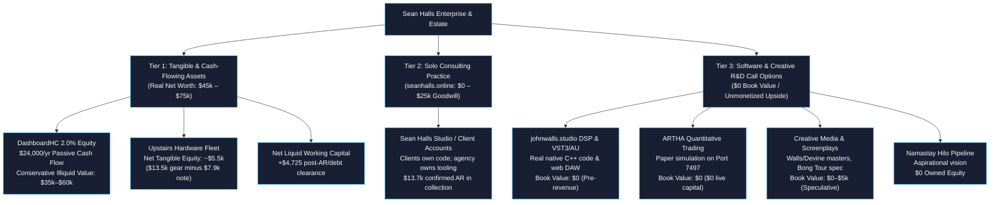

# Sean Halls Enterprise Asset Portfolio & Intellectual Property Master Registry

**Classification**: STRICTLY CONFIDENTIAL // PROPRIETARY IP // INTERNAL USE ONLY  
**Holding Architecture**: Sean Halls Multi-Division Enterprise (`seanhalls_online`, `cgu_master`, `sh_hub`, `DashboardHC`, `johnwalls_studio`, `ARTHA`)  
**Date of Record**: October 6, 2026 (Radical Honesty Audit Baseline)  
**Audited Status**: Grounded Reality — Zero AI Valuation Inflation

---

## 1. Executive Summary & Honest Operating Architecture

The enterprise consists of three clear tiers: **Liquid & Tangible Assets** (real money and hardware), **Proven Cash-Flowing Equity** (DashboardHC), and **R&D / Creative Intellectual Property** (software, plugins, screenplays, and algorithms currently in pre-revenue stage):

---

## 2. Master Intellectual Property & Asset Register (Grounded Reality)

| Asset ID | Asset Name & Description | Division | Real Status | Current Book Value | Fair Market / Secondary Value | Verifiable Annual Cash Flow | Bank Collateral Reality |
| :--- | :--- | :--- | :--- | :--- | :--- | :--- | :--- |
| `asset-dashboardhc-equity` | **DashboardHC (Data Services Partners LLC) 2.0% Equity** Permanent minority equity in $2M ARR enterprise post-acute care SaaS | Financial Asset | Active & Verified | **$40,000** | **$35,000 – $60,000** *(applied 40-50% private illiquidity discount)* | **$24,000 / yr** ($6,000/qtr K-1) | **YES ($40,000)** |
| `asset-hardware-fleet` | **Hardware Fleet & ASUS Ascent GX10 Workstation** ASUS Ascent GX10 (NVIDIA DGX Spark GB10 128GB VRAM) + Apple Silicon M-series fleet | Tangible Property | Active On-Prem | **$5,541** | **$5,500 – $8,500** *($13.5k market value minus $7.96k note)* | $0 | **YES ($8,000)** |
| `asset-working-capital` | **Liquid Cash & Confirmed Receivables** $3,500 checking + $13,725 confirmed AR minus $12,500 Amex payoff | Liquid Capital | Active | **$4,725** | **$4,725 – $7,525** *(with potential $2.8k state tax recovery)* | N/A | Cash |
| `asset-seanhalls-studio` | **Sean Halls Studio Consultancy (`seanhalls.online`)** Solo consulting practice with 10 active client contracts; clients own deliverable code | Agency Practice | Active Operations | **$0** | **$0 – $25,000** *(solo dev practices without retainers have minimal transferable value)* | Varies (~$40k–$80k SDE) | **$0** |
| `asset-johnwalls-studio` | **johnwalls.studio C++ DSP Engine & VST3/AU Plugin** Native C++ audio engine (Mesa/Vox/stompboxes), JUCE VST plugin, SP-404 MKII web DAW, Ableton telemetry | Creative Software | Production Live | **$0** | **$5,000 – $15,000** *(software code replacement value only; $0 live revenue today)* | **$0** *(pre-revenue)* | **$0** |
| `asset-artha-quant` | **ARTHA Quantitative Trading Strategy & Data** 109.2M bar historical warehouse, Maya RL algorithm, IBKR Port 7497 simulation | Quantitative R&D | Paper Simulation | **$0** | **$0 – $10,000** *(paper simulation with $0 live capital has zero market/lending value)* | **$0** | **$0** |
| `asset-walls-devine-vol1` | **Walls / Devine Volume 1: Master Tracks** 8 commercial master tracks (100% sync-cleared) | Creative Media | Exclusive Master | **$1,000** | **$1,000 – $5,000** *(speculative sync placement potential)* | Nominal | **$0** |
| `asset-bong-tour` | **Bong Tour: Feature Film Spec Screenplay** 110-page spec screenplay draft and treatment | Creative Media | Unoptioned Spec | **$0** | **$0** *(spec scripts have zero balance sheet value until optioned)* | $0 | **$0** |
| `asset-appreesh-solana` | **Appreesh: Solana Protocol Code** Anchor Solana smart contracts | Crypto R&D | Staging / Codebase | **$0** | **$0** *(unlaunched tokens/contracts have zero balance sheet value)* | $0 | **$0** |
| `asset-namastay-hilo` | **Namastay Downtown Hilo Pipeline** Aspirational vision for retreat real estate in Hawaii | Real Estate Target | Unowned Target | **$0** | **$0** *(future acquisition target; zero current owned equity)* | $0 | **$0** |
| **TOTALS** | **Consolidated Real Estate & Asset Footprint** | — | — | **$51,266** | **$51,000 – $120,000** | **$24,000 / yr** | **$48,000** |

---

## 3. Near-Term Liquidity & Debt Elimination Waterfall

- **Current Liquid Cash**: $3,500.00
- **Confirmed Incoming Receivables**: $13,725.00 (TBM $7,500, CGU $4,700, Cluck $1,225, Western $300)
- **Active Revolving Card Balance (Amex)**: -$12,500.00
- **Near-Term Liquid Position Post-Payoff**: **+$4,725.00** unencumbered cash buffer (or **+$7,525.00** if the $2,800 CA tax refund arrives).
- **Equipment Note Liability**: ASUS Ascent GX10 equipment note is $1,350.00/mo starting Nov 4, 2026 ($7,959.04 total at 17.99% APR), pre-funded by monthly consulting surplus and K-1 distributions.

---

## 4. Grounded Real-World Takeaway

1. **What is Real and Bankable**:
   - The **$24,000/year** passive distributions from DashboardHC (2% equity) is the true bedrock financial asset.
   - Physical compute hardware provides ~$5,500 in net equity.
   - Incoming receivables clear all revolving credit card debt and leave ~$4,700 in cash.
2. **What is Pure Upside / Call Options (Valued at $0 on Balance Sheet)**:
   - `johnwalls.studio` is an exceptional piece of audio engineering and a working VST plugin, but until musicians buy it or subscribe, it is an active creative project, not an enterprise asset.
   - `ARTHA` is a paper-trading research project with zero live capital.
   - `Namastay` is a dream pipeline, not owned real estate.
   - `Bong Tour` and `Appreesh` are speculative creative assets with zero book value today.
3. **Total Honest Net Worth**:
   - **Hard Liquidation Floor**: **~$45,000 – $60,000**
   - **Going Concern (with agency goodwill)**: **~$75,000 – $120,000**
