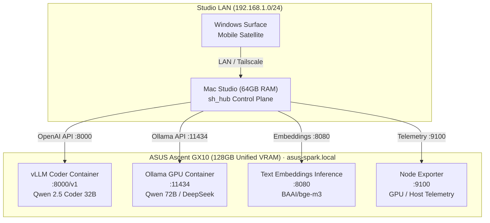

# ASUS Ascent GX10 NVIDIA DGX Spark GB10 Workstation Deployment Playbook
**Document Version:** 1.0.0  
**Target Arrival Window:** October 8 – 13, 2026  
**Physical Sanctum:** Upstairs Hub Room (2826 S 500 E)  
**Primary Role:** Dedicated High-Throughput Frontier Inference Node (128GB Unified VRAM)  
**Cluster Integration:** `sh_hub` Fleet Orchestration (`node-nvda-spark`)  

---

## 1. Executive Summary & Asset Profile

The **ASUS Ascent GX10 NVIDIA DGX Spark GB10** is the cornerstone capital computing asset of the Sean Halls studio operations. Equipped with **128GB of high-speed Unified VRAM**, a 1TB Gen4 NVMe SSD, and dedicated NVIDIA Tensor Core hardware, this workstation transitions the studio into **"ASUS-Land"** — an on-premises, zero-cloud-egress AI engineering sanctum.

### Hardware & Financial Profile
| Attribute | Specification | Operational Context |
| :--- | :--- | :--- |
| **Asset Identifier** | `asset-asus-gx10-spark` | Registered in `sh_hub` capital assets registry |
| **GPU / Memory** | NVIDIA DGX Spark GB10 / **128GB Unified VRAM** | Houses unquantized 32B or AWQ/GGUF 72B models with zero swap |
| **Internal Storage** | 1TB NVMe Gen4 SSD (Dedicated weights cache) | Holds Qwen 2.5 Coder, DeepSeek Coder, BGE-M3 embeddings |
| **Networking** | 10GbE / 2.5GbE RJ-45 LAN + Wi-Fi 6E | Hardwired to studio gigabit switch (`192.168.1.0/24`) |
| **Financing Structure** | 6-Month Equipment Note ($1,350/mo) | Starts Nov 4, 2026 ($0 due in Oct); $7,959.04 total |
| **Appreciation Thesis** | $8,500 – $10,500+ Secondary Market Value | High enterprise scarcity for unified 128GB workstations |
| **Target Payoff Source** | Single client PPO milestone ($7.5k–$18.5k) | Followup Care / CGU sprint revenue covers the entire asset |

---

## 2. Physical Placement & Hardware Sanctum

All central database storage, compute orchestration, and inference nodes are permanently housed in the **Upstairs Hub Room** at 2826 S 500 E.

### Unboxing & Physical Bench Setup
1. **Unboxing Inspection**:
   - Inspect outer chassis and seals for any transit impact.
   - Verify power supply cord, Wi-Fi antennas, and accessory pack.
2. **Placement & Thermal Clearance**:
   - Place on the dedicated equipment credenza in the Upstairs Hub Room.
   - Ensure a minimum of **6 inches (15 cm) clearance** around intake and exhaust fans.
   - Maintain ambient room temperature below 74°F (23°C).
3. **Power Architecture**:
   - Plug into a clean surge-protected power circuit (UPS battery backup recommended).
   - Ensure standard 120V 15A circuit availability.
4. **Wired Networking**:
   - Connect Cat6/Cat6a patch cable from the workstation's primary 10GbE/2.5GbE port to the upstairs network switch.
   - Verify link lights negotiate at 1Gbps / 2.5Gbps / 10Gbps.

---

## 3. Operating System & Base Bootstrap

The workstation runs **Ubuntu 24.04 LTS (or 22.04 LTS)** Server/Desktop with proprietary NVIDIA datacenter/desktop drivers.

### Step 1: Operating System Installation
- Install Ubuntu 24.04 LTS via USB boot drive.
- Set Hostname: `asus-spark`.
- Create administrative user: `sh-admin` (or preferred studio handle).
- Enable OpenSSH Server during installation.

### Step 2: Automated Bootstrap Script Execution
Transfer or clone the pre-engineered bootstrap suite from `sh_hub`:

```bash
# On the ASUS workstation:
mkdir -p ~/sh-cluster && cd ~/sh-cluster

# Copy bootstrap script from your Mac Studio or repository:
# scp seanhalls@mac-studio.local:/Users/seanhalls/Desktop/sh/scripts/asus-land/bootstrap-ubuntu.sh .
chmod +x bootstrap-ubuntu.sh
sudo ./bootstrap-ubuntu.sh
```

### What `bootstrap-ubuntu.sh` Configures Automatically:
1. **NVIDIA Driver 560+ and CUDA 12.6 Toolkit**: Installs the production CUDA runtime.
2. **Docker Engine & NVIDIA Container Toolkit**: Configures `/etc/docker/daemon.json` with the `nvidia` default runtime so all containers have full access to the 128GB VRAM pool.
3. **Local mDNS (`avahi-daemon`)**: Broadcasts `asus-spark.local` on the LAN so Mac Studio and Windows Surface satellites connect without hardcoded IPs.
4. **Gate 6 Fail-Closed Firewall (`ufw`)**:
   - Allows port `22` (SSH), `8000` (vLLM API), `11434` (Ollama API), `8080` (TEI Embeddings), and `9100` (Node Exporter) **ONLY** from the local studio subnet `192.168.1.0/24`.
   - Explicitly **DENIES** live broker socket ports `7496` and `4001` to enforce Gate 6 fail-closed isolation.
   - Drops all incoming public internet WAN connections.
5. **Storage Directories**: Prepares `/opt/sh-models/huggingface` and `/opt/sh-models/ollama` with optimized permissions for weight caching.

---

## 4. Containerized Inference Cluster Stack

The inference infrastructure is orchestrated via Docker Compose (`/opt/sh-cluster/docker-compose.yml`).

### Compose Topology


### Launching the Stack:
```bash
cd /opt/sh-cluster
sudo docker compose pull
sudo docker compose up -d
sudo docker compose ps
```

### Service Breakdown:
1. **`vllm-coder` (Port 8000)**:
   - Primary high-throughput OpenAI-compatible endpoint.
   - Default Model: `Qwen/Qwen2.5-Coder-32B-Instruct`.
   - VRAM Utilization: ~48GB (32k token context window, FP16/BF16 weights).
   - Serves `sh_hub` automated coding tasks, syntax generation, and multi-file refactoring.
2. **`ollama-gpu` (Port 11434)**:
   - Rapid-testing endpoint for quantized heavy models.
   - Pulls and serves `qwen2.5-coder:72b-instruct-q4_K_M` (~44GB VRAM) and `deepseek-coder-v2:16b`.
   - Ideal for adversarial review and deep architectural second-opinions.
3. **`tei-embeddings` (Port 8080)**:
   - Hugging Face Text Embeddings Inference running `BAAI/bge-m3`.
   - Sub-10ms dense vector embeddings for semantic search over all studio repositories (`sh_hub`, `cgu_master`, `seanhalls_online`, `clients`).
4. **`node-exporter` (Port 9100)**:
   - Exposes system metrics (CPU, RAM, GPU temperature, VRAM allocation) to `sh_hub`.

---

## 5. Systemd Auto-Recovery Service

To guarantee 100% uptime after power events, install the systemd unit:

```bash
sudo cp /opt/sh-cluster/systemd/sh-spark-cluster.service /etc/systemd/system/
sudo systemctl daemon-reload
sudo systemctl enable sh-spark-cluster.service
sudo systemctl start sh-spark-cluster.service
sudo systemctl status sh-spark-cluster.service
```

With this enabled, the entire inference stack boots and warms up within 45 seconds of machine power-on.

---

## 6. Remote Verification from Mac Studio

Once the ASUS workstation is running, verify cluster connectivity directly from the Mac Studio:

```bash
# Run the automated verification probe:
/Users/seanhalls/Desktop/sh/scripts/asus-land/verify-cluster.sh
```

### Expected Output:
- [x] mDNS ping to `asus-spark.local` (< 2ms over LAN).
- [x] Port 8000 (vLLM) HTTP 200 OK responding to `/v1/models`.
- [x] Port 11434 (Ollama) HTTP 200 OK responding to `/api/version`.
- [x] Port 8080 (TEI) HTTP 200 OK responding to `/health`.
- [x] Gate 6 Safety: Sockets 7496 and 4001 connection refused / closed (FAIL-CLOSED).

---

## 7. `sh_hub` Fleet Orchestration Integration

The `sh_hub` engine dynamically balances inference across the physical fleet:

```typescript
// Priority Cascade in sh_hub/src/services/inference-dispatcher.ts:
// Priority 1: ASUS Spark vLLM (Qwen 2.5 Coder 32B) -> asus-spark.local:8000
// Priority 2: ASUS Spark Ollama (Qwen 72B / DeepSeek) -> asus-spark.local:11434
// Priority 3: Mac Studio Ollama (Metal/MPS Qwen 32B) -> 127.0.0.1:11434
// Priority 4: Deterministic calibrated offline fallback engine
```

### Operational REST Endpoints in `sh_hub`:
- **`GET /fleet/nodes`**: Real-time inventory of all physical nodes, VRAM capacities, and health.
- **`GET /fleet/probe`**: Actively ping all cluster endpoints and measure round-trip latency.
- **`GET /fleet/readiness`**: Validates deployment scripts, compose manifests, and Gate 6 compliance.
- **`POST /fleet/dispatch`**: Dispatches inference prompts with automatic cluster failover and token telemetry.

---

## 8. Client Privacy & HIPAA Data Isolation Protocols

When working on client engagements (e.g. Followup Care in `clients/followup_master`):
1. **Zero Cloud Egress**: All code indexing, embeddings, and prompt completions run 100% on the local LAN between the Mac Studio and the ASUS GX10.
2. **Patient Data Quarantine**: No real or synthetic patient health information (PHI) leaves the premises.
3. **Gate 6 Compliance**: Live broker sockets (ports 7496 / 4001) remain hard-locked; no algorithmic trading execution touches this inference cluster.

---

## 9. Day 1 Acceptance Checklist (Oct 8–13)

- [ ] Unbox and place ASUS GX10 in Upstairs Hub Room.
- [ ] Connect Cat6 cable to 10GbE port; verify LAN connection.
- [ ] Boot Ubuntu 24.04 LTS and verify `nvidia-smi` reports 128GB Unified VRAM.
- [ ] Run `sudo ./bootstrap-ubuntu.sh` to configure CUDA, Docker, and Gate 6 UFW firewall.
- [ ] Start Docker Compose stack (`sudo docker compose up -d`).
- [ ] Run `ollama pull qwen2.5-coder:72b` to seed quantized 72B model.
- [ ] Execute `verify-cluster.sh` from Mac Studio.
- [ ] Verify `sh_hub` Admin Console displays **192GB Total Cluster VRAM** and `READY_FOR_DEPLOYMENT`.
