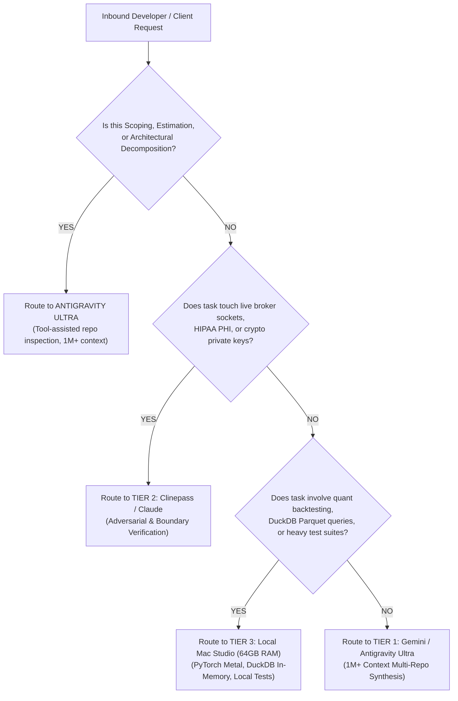

# Compute Distribution & Automated Coding Operations Playbook

**Document Identifier**: `PLAYBOOK-COMPUTE-OPS-2026-01`  
**Studio Entity**: **seanhalls.online** / **sh_hub**  
**Classification**: Internal Studio Operations & Engineering SOP  
**Primary Workstation**: Apple Silicon Mac Studio (64GB Unified Memory · Metal/MPS)  
**Cluster Scale-Out Node**: ASUS Ascent GX10 DGX Spark GB10 (128GB Unified VRAM · Upstairs Sanctum)  
**Frontier & Adversarial Cloud Runtimes**: Google Gemini / Antigravity Ultra (1M+ context), Clinepass / Claude Sonnet/Opus  

---

## Executive Summary: Multi-Tier Compute Distribution

Modern agentic engineering requires allocating available compute dynamically based on **context requirements**, **security/compliance blast radius**, and **computational density**. Instead of relying on a monolithic model or expecting smaller local models (e.g. Gemma 26B) to handle complex architectural estimation without codebase context, our workflow routes workloads into three specialized compute tiers:

```
┌────────────────────────────────────────────────────────────────────────────────────────┐
│                              REQUEST INTAKE & SCOPING TRIAGE                           │
│     (Antigravity Ultra: 1M+ Context, Tool-Assisted Multi-Repo Codebase Inspection)     │
└──────────────────────────────────────────────────┬─────────────────────────────────────┘
                                                   │
         ┌─────────────────────────────────────────┼────────────────────────────────────────┐
         │                                         │                                        │
         ▼                                         ▼                                        ▼
┌───────────────────────────────┐ ┌───────────────────────────────┐ ┌───────────────────────────────┐
│ TIER 1: EVERYDAY DEVELOPMENT  │ │ TIER 2: ADVERSARIAL & SAFETY  │ │ TIER 3: LOCAL WORKHORSE       │
│ (Gemini / Antigravity Ultra)  │ │ (Clinepass / Claude)          │ │ (Mac Studio 64GB Unified RAM) │
├───────────────────────────────┤ ├───────────────────────────────┤ ├───────────────────────────────┤
│ • 1M+ context window          │ │ • Surgical boundary audits    │ │ • 64GB Unified Memory (Metal) │
│ • Cross-repo workspace sync   │ │ • SEC Rule 15c3-5 controls    │ │ • In-memory DuckDB analytics  │
│ • Web features (Next.js/React)│ │ • Gate 6 live broker locks    │ │ • 193 pytest suites local     │
│ • Ramone PHP/Kadence themes   │ │ • Followup HIPAA isolation    │ │ • 118 vitest suites local     │
│ • UI dashboards & API routes  │ │ • Appreesh Solana crypto SPL  │ │ • Fast code assist (Qwen 32B) │
└───────────────────────────────┘ └───────────────────────────────┘ └───────────────────────────────┘
                                                   │
                                                   ▼
┌────────────────────────────────────────────────────────────────────────────────────────┐
│                sh_hub: LOCAL-FIRST SQLite TELEMETRY, TIMEKEEPING & BILLING             │
│                      (.hub-data/sh-hub.sqlite -> /billing/prepared-invoices)           │
└────────────────────────────────────────────────────────────────────────────────────────┘
```

---

## 1. Compute Fleet Topology & Hardware Registry

### Tier 1: Cloud Frontier & Massive-Context Agentic Engine
- **Primary Engine**: Google Gemini (Gemini 2.5 / 3.0 Pro & Flash) via Antigravity Ultra.
- **Context Profile**: 1M+ to 2M tokens native input context.
- **Role**: High-velocity code generation, broad multi-repo refactoring, documentation synthesis, and full-stack implementation across active workspace worktrees.

### Tier 2: Surgical Adversarial & Safety Verification Engine
- **Primary Engine**: Anthropic Claude (Claude 3.5 Sonnet / Claude 3.0 Opus) via Clinepass.
- **Context Profile**: Focused 200k context window with deep step-by-step chain-of-thought verification.
- **Role**: Pre-merge red-teaming, security auditing, formal logic verification of regulatory filters, smart contract invariants, and patient privacy boundaries.

### Tier 3: Local Bare-Metal Execution Workhorse (Mac Studio 64GB)
- **Primary On-Premises Host**: **Apple Silicon Mac Studio (M-Series, 64GB Unified High-Bandwidth Memory · Metal/MPS)** in the upstairs hub room.
  - **Memory Allocation Budget (64GB Total)**:
    - **Metal / MPS GPU Compute (~32GB–48GB wired limit)**: Native acceleration for PyTorch, MLX, and optional local coding inference.
    - **In-Memory Analytical Engine (~8GB–16GB)**: DuckDB in-process analytics querying local Parquet files with zero disk swapping.
    - **Build & Test Workers (~8GB–16GB)**: Parallel Node.js, Python, and Vite processes executing 193 pytest + 118 vitest suites concurrently.
  - **Local Model Serving (Retiring Gemma for Coding)**:
    - Gemma 26B/27B is deprecated for code generation and scoping due to lack of codebase grounding and hallucinated hour estimations.
    - If local offline code assist is desired on the Mac Studio, deploy **Qwen 2.5 Coder 14B or 32B (Q4_K_M)** via Ollama or MLX (~9GB–20GB VRAM footprint), keeping 44GB+ free for DuckDB and IDE processes.
- **Scale-Out Hardware Node**: **ASUS Ascent GX10 NVIDIA DGX Spark GB10 AI Workstation** (128GB Unified VRAM, 1TB NVMe SSD). Dedicated to high-parameter quant research, private vector indexing, and zero-data-leakage client compute upon deployment.

### Satellite Layer: Windows Surface + GitHub Copilot (Mobile Agile Authoring & QA)
- **Primary Host**: **Microsoft Windows Surface (`node-windows-surface`)** running Windows 11 / x86_64.
- **Primary Tool**: **GitHub Copilot & Copilot Chat** in VS Code ($100/yr flat license · zero incremental token cost).
- **Operational Role**:
  - **Inline Keystroke Autocomplete**: Zero-marginal-cost micro-scaffolding, function signatures, boilerplate test stubs, docstrings, and tab-completions while in active flow.
  - **Mobile Satellite Engineering**: Remote pairing back to the upstairs Mac Studio (64GB) via SSH or VS Code Remote Tunnels when developing untethered from the hub room.
  - **Cross-Platform & Stylus QA**: Visual validation on Windows 11, Microsoft Edge rendering parity, and pen/touch responsiveness for client web apps.
  - **Hierarchy Alignment**: Copilot operates as an agile, low-latency co-pilot for direct line-by-line coding, leaving high-context multi-repo architectural scoping to Antigravity Ultra and compliance gating to Claude.

---

## 2. Request Intake & Workload Routing Matrix

When an operational request, ticket, or developer prompt enters the system, apply the following triage rules:



| Task Category | Primary Compute Tier | Verification Requirement |
| :--- | :--- | :--- |
| **Milestone Scoping & Hour Estimation** | **Antigravity Ultra (Gemini 1M+)** | Grounded repo inspection (`view_file`, `grep_search`) |
| **Full-Stack Features & UI** | Tier 1 (Gemini / Antigravity Ultra) | Automated build (`npm run build`) |
| **PHP / WordPress Templates** | Tier 1 (Gemini / Antigravity Ultra) | PHP lint & Kadence theme visual check |
| **Cross-Repo Architectural Sync** | Tier 1 (Gemini / Antigravity Ultra) | Workspace manifest & link integrity check |
| **Broker Gate 6 / Socket Locks** | Tier 2 (Clinepass / Claude) | Port 7496/4001 fail-closed assertion |
| **SEC Rule 15c3-5 Pre-Trade Risk** | Tier 2 (Clinepass / Claude) | Order limit & throttle unit validation |
| **HIPAA PHI & MSSQL Queries** | Tier 2 (Clinepass / Claude) | Migration compile verification (`SET NOEXEC ON`) |
| **Solana SPL Smart Contracts** | Tier 2 (Clinepass / Claude) | Signature & account ownership audit |
| **Tokonawaki Quant Research** | Tier 3 (Mac Studio 64GB Metal/MPS) | PyTorch Metal runtimes & DuckDB in-memory queries |
| **Automated Test Sweeps (311 tests)** | Tier 3 (Mac Studio 64GB Local) | 193 pytest + 118 vitest clean pass (<30s) |
| **Inline Autocomplete & Mobile Commits** | Satellite (Windows Surface + Copilot) | Zero-token local flow & syntax validity |
| **Edge / Windows Touch & Stylus QA** | Satellite (Windows Surface) | Touch gesture responsiveness & layout parity |

---

## 3. The Antigravity Scoping Protocol: Why Gemma Failed & How We Fix It

### 3.1. Post-Mortem: Why Local Gemma 26B Produced Bad Predictions
When inbound unstructured client requests (such as Followup Care email feature lists) were passed to `gemma4:26b` running inside local Ollama, the model consistently produced flawed scoping:
1. **Zero Codebase Grounding**: Gemma operated in a vacuum. It could not inspect the actual MSSQL stored procedures (`migration_sql/`), check Swagger endpoint definitions (`deployment/api/swagger.yaml`), or inspect Angular form components.
2. **Context Starvation**: Running a 26B parameter model locally with small context windows truncates existing project documentation, preventing the model from recognizing architectural conventions or cross-surface constraints.
3. **Hallucinated Effort & Output Fragility**: Lacking frontier reasoning capabilities, Gemma fabricated generic boilerplate tasks and arbitrary hour estimations detached from realistic contractor rates ($185/hr, $2,500 minimums) and production complexity.

### 3.2. Case Study: Followup Care Platform Sprint (Gemma Zero-Shot vs. Code-Grounded Reality)

Gemma produced a standard conservative agency estimate ($9,500 across 34–67 hours; median 51h) because it estimated purely from raw problem statements without inspecting the underlying code. 

When the actual codebase in [`clients/followup_master`](file:///Users/seanhalls/Desktop/sh/clients/followup_master) is inspected with tool-assisted grounding, the real direct engineering effort drops to **8–12 hours**:

| Email Issue | Code Location | Gemma Est. | Real Engineering Effort (Grounded Reality) |
| :--- | :--- | :--- | :--- |
| **1. Discharge Phone Validation** | `patient-form.component.ts` (L426–428) | 5–10 hrs | **0.5–1.0 hr**: `patientPhoneNumber` already contains regex; it only lacks `Validators.required`. Adding the validator and template asterisk `*` solves it completely. |
| **2. Phone Loading Latency** | MSSQL `sp_GetDischargeQueue` & `tblPatientContacts` | 8–16 hrs | **2.0–3.0 hrs**: Add non-clustered index on foreign key `patientId` in MSSQL and verify index usage in execution plan. |
| **3. Archived vs. Inactive** | `patient-list.component.ts` & template | 4–8 hrs | **1.0–1.5 hrs**: Distinguish badge styles (Amber vs. Slate) and add status filter dropdown option. |
| **4. Hospital Character Truncation** | MSSQL column width + CSS `max-width` | 4–7 hrs | **1.0 hr**: Expand `patientHospitalAdmitted` from `VARCHAR(50)` to `VARCHAR(255)` and remove ellipsis clipping in the sheet template. |
| **5. DOT Push Notifications** | `followup-api/src/services/notifications/` | 6–12 hrs | **2.0–3.0 hrs**: Add structured logging to WebSocket dispatch emitter to trace delivery drops. |
| **6. Lone Tree Gunther Stuck Queue** | MSSQL discharge queue query | 4–8 hrs | **1.0 hr**: Transition the single stale 2024 record to closed and add a 6-month cutoff date filter to the queue query. |
| **7. Recon Typography Glitch** | `recon-questions.component.scss` | 3–6 hrs | **0.5 hr**: Fix subpixel clipping by bumping `line-height` from tight 1.0 to 1.4 and adding 2px padding. |
| **TOTALS** | *Cross-surface sprint* | **34–67 hrs ($9.5k / 51h med)** | **8–12 hrs (~$1.5k–$2.2k direct cost)** |

#### Strategic PPO Packaging & Realization Rate
- **The Agency Trap**: Quoting Gemma’s ungrounded 51 hours ($9,500) introduces pricing friction, slows sales velocity, and risks client pushback.
- **The Grounded Advantage**: By knowing the actual effort is 8–12 hours, the studio can package this sprint as a streamlined flat-fee Pay-Per-Outcome (PPO) milestone at **$3,000–$4,000**.
- **Economic Realization**:
  - The client receives a 60% discount off standard agency billing ($3,500 vs. $9,500) with locked scope and guaranteed delivery.
  - The studio captures a **$300–$375+/hr effective hourly realization rate** on clean, verified senior commits.

### 3.3. The Antigravity Scoping Standard
Technical estimation and milestone scoping are **high-cognitive, tool-interactive operations** performed once per deliverable. Antigravity Ultra is designated as the official scoping engine:
1. **Interactive Tool Grounding**: Antigravity actively executes `grep_search`, `view_file`, and `list_dir` across `followup-api/`, `followup-frontend/`, `cgu_master/`, or `occ/` before generating estimates.
2. **1M+ Token Context Ingestion**: Entire project repositories, historical SOW evidence packets, and architecture manifests are ingested simultaneously.
3. **Calibrated Milestone Packaging**: Decomposes requests into discrete, verifiable work items with low/high hour bounds, complexity multipliers, and concrete acceptance criteria formatted for `sh_hub` SQLite persistence (`portal_estimate_requests`).

---

## 4. High-Stakes Boundary Verification Protocols

When changes cross into Tier 2, strict validation criteria must be satisfied prior to release:

### 4.1. SEC Rule 15c3-5 Pre-Trade Financial Risk Filtering (`quant/tokonawaki`)
- **Mandate**: Prevent erroneous, rogue, or out-of-bounds orders from reaching execution venues.
- **Checks Required**:
  1. Capital allocation cap check (order size cannot exceed pre-configured max dollar value).
  2. Order rate throttling (rate-limiter must block high-frequency order bursts exceeding threshold).
  3. Pre-trade credit threshold verification against real-time account buying power.
  4. Non-bypassable filter placement: Risk filters must execute in the synchronous order pipeline prior to any socket write.

### 4.2. Gate 6 FAIL-CLOSED Live Port Lock (`quant/tokonawaki`)
- **Mandate**: Guarantee that development, backtesting, or simulation processes NEVER open network sockets to live brokerage endpoints (Interactive Brokers live port `7496`, paper port `4001`).
- **Checks Required**:
  1. Fail-closed socket guard must remain active.
  2. Zero outbound connections permitted on live broker ports during research/test loops.
  3. Socket wrapper must raise an uncatchable fatal exception if execution mode is not explicitly signed as live-authorized.

### 4.3. HIPAA Title II Patient Data Isolation (`clients/followup_master`)
- **Mandate**: Safeguard Protected Health Information (PHI) across the Node.js API, Angular frontend, and MSSQL database.
- **Checks Required**:
  1. Zero PHI in logs, query telemetry, or error messages (enforce field-level redaction).
  2. Tenant & Operation Group separation: Ensure stored procedures (`sp_getActivePatientsByOperationId`, `sp_getPatientCallsByOperationId`) strictly enforce `operationId` filtering.
  3. Additive migration protocol: Always validate migrations using `SET NOEXEC ON` + `sqlcmd -b` against an isolated alpha database before touching live schemas.

### 4.4. Solana SPL Cryptographic Security (`appreesh_master`)
- **Mandate**: Secure digital asset minting, tipping, and wallet interaction.
- **Checks Required**:
  1. Transaction signing authority validation.
  2. Reentrancy and instruction ordering verification.
  3. Strict sanitization of client-supplied public keys and RPC connection endpoints.

---

## 5. Recommended Daily Operational Workflow

### 5.0. Inbound Scoping & Estimation (Antigravity Ultra)
1. **Intake Processing**: Ingest client emails or ticket scopes via `sh_hub` automated intake or direct prompt.
2. **Grounding Phase**: Antigravity navigates to the target repository, audits existing routes and database schemas, and flags technical dependencies.
3. **Outcome Generation**: Outputs structured JSON work items into `portal_estimate_requests` and creates draft Pay-Per-Outcome milestones in `project_outcomes`.

### 5.1. Everyday Development (Gemini / Antigravity Ultra)
1. **Workstation Setup**:
   - Open root workspace (`/Users/seanhalls/Desktop/sh`) on the **Mac Studio (64GB RAM)**.
   - Active repositories: [`cgu_master`](file:///Users/seanhalls/Desktop/sh/cgu_master), [`seanhalls_online`](file:///Users/seanhalls/Desktop/sh/seanhalls_online), [`sh_hub`](file:///Users/seanhalls/Desktop/sh/sh_hub), [`clients/ramone_master`](file:///Users/seanhalls/Desktop/sh/clients/ramone_master), [`appreesh_master`](file:///Users/seanhalls/Desktop/sh/appreesh_master).
2. **Context-Heavy Feature Buildout**:
   - Leverage Gemini’s 1M+ context window to ingest entire cross-repo dependency chains without context truncation.
   - Author frontend components, Next.js routes, API controllers, and state bridges.
3. **Ramone PHP & Kadence Customization**:
   - Implement PHP hooks, Kadence template overrides, and WooCommerce workflows under [`clients/ramone_master/occ`](file:///Users/seanhalls/Desktop/sh/clients/ramone_master/occ).
   - Ensure clean separation between custom child theme code and core Kadence assets.
4. **Dashboard & Control Surface Integration**:
   - Update `sh_hub` control plane and client billing telemetry.
   - Synchronize shared work manifests via `cgu_master` (`npm run sync:work-module`).

### 5.2. Adversarial & Safety Validation (Clinepass / Claude)
1. **Boundary Trigger Activation**:
   - Whenever a feature touches financial risk filters, broker sockets, patient records, or crypto logic, invoke Claude surgically via Clinepass.
2. **Red-Team Boundary Review**:
   - Prompt Claude with explicit adversarial instructions to find edge-case bypasses:
     - *"Can an order bypass the 15c3-5 check if an invalid symbol or overflow quantity is provided?"*
     - *"Does any code path allow a socket connection to port 7496 when Gate 6 is enabled?"*
     - *"Does this MSSQL stored procedure leak patient rows when operationId is NULL or malformed?"*
3. **Evidence Artifacting**:
   - Record audit outcomes, test diffs, and verification receipts in repository evidence folders before approving production merges.

### 5.3. Quant Lab Execution (Local Compute / Mac Studio 64GB)
1. **Unified Memory Workhorse**:
   - Run `tokonawaki` natively on the upstairs Mac Studio utilizing Apple Silicon Metal/MPS.
   - Allocate 16GB+ to the DuckDB in-process analytical cache to query partitioned Parquet files at zero network latency.
2. **Air-Gapped Alpha Preservation**:
   - Zero egress: Keep all financial tick data, order logs, and proprietary trading strategies strictly on local NVMe storage.
3. **Automated Test Sweeps (311 Tests Total)**:
   - **Python Backend**: Run the complete **193 pytest** test suite locally against the DuckDB analytical engine:
     ```bash
     cd /Users/seanhalls/Desktop/quant/tokonawaki
     pytest tests/ -v
     ```
   - **Frontend UI**: Run the complete **118 vitest** test suite locally against `quant_ui`:
     ```bash
     cd /Users/seanhalls/Desktop/quant/tokonawaki/quant_ui
     pnpm vitest run
     ```
   - The Mac Studio’s 64GB unified memory executes all 311 tests in parallel without memory paging.

---

## 6. Hub Telemetry, Timekeeping & Billing Integration

To maintain accurate operational records and compute accounting:

1. **Local-First SQLite Persistence**:
   - All timekeeping events, token consumption estimates, and milestone logs are stored in [`sh_hub/.hub-data/sh-hub.sqlite`](file:///Users/seanhalls/Desktop/sh/sh_hub/.hub-data/sh-hub.sqlite).
2. **Token Pricing & Allocation Model**:
   - Local Mac Studio (64GB) compute is logged at **$0 external token cost** with fixed hardware amortization.
   - Antigravity Ultra and Claude API usage is attributed to client allocations based on [`sh_hub/src/services/compute-allocations.ts`](file:///Users/seanhalls/Desktop/sh/sh_hub/src/services/compute-allocations.ts).
3. **Invoice Draft Preparation**:
   - Draft invoices generated in `/billing/prepared-invoices*` aggregate verified milestone deliverables, compute tier costs, and senior engineering hours automatically.

---

## 7. Fast-Path Command Reference

### Scoping & Intake Validation
```bash
# Verify sh_hub estimation engine & tests:
cd /Users/seanhalls/Desktop/sh/sh_hub && npm test
```

### Daily Development & Linting (Tier 1)
```bash
# Verify CGU build:
cd /Users/seanhalls/Desktop/sh/cgu_master && npm run build

# Verify Sean Halls Online build:
cd /Users/seanhalls/Desktop/sh/seanhalls_online && npm run build
```

### Quant Lab Local Test Sweeps (Tier 3: Mac Studio 64GB)
```bash
# Run Tokonawaki 193 pytest suite:
cd /Users/seanhalls/Desktop/quant/tokonawaki && pytest tests/

# Run Quant UI 118 vitest suite:
cd /Users/seanhalls/Desktop/quant/tokonawaki/quant_ui && pnpm vitest run

# Check Apple Silicon GPU allocation limit:
sysctl iogpu.wired_mem_limit
```

### High-Stakes Boundary Verification (Tier 2)
```bash
# Verify Followup MSSQL migration syntax without execution:
cd /Users/seanhalls/Desktop/sh/clients/followup_master/followup-api
sqlcmd -S localhost -d followup_alpha -b -Q "SET NOEXEC ON" -i migration_sql/latest.sql

# Assert Gate 6 live broker port isolation (returns empty if locked):
lsof -i :7496 -i :4001 || echo "Gate 6 LOCK CONFIRMED: No open broker sockets."
```
