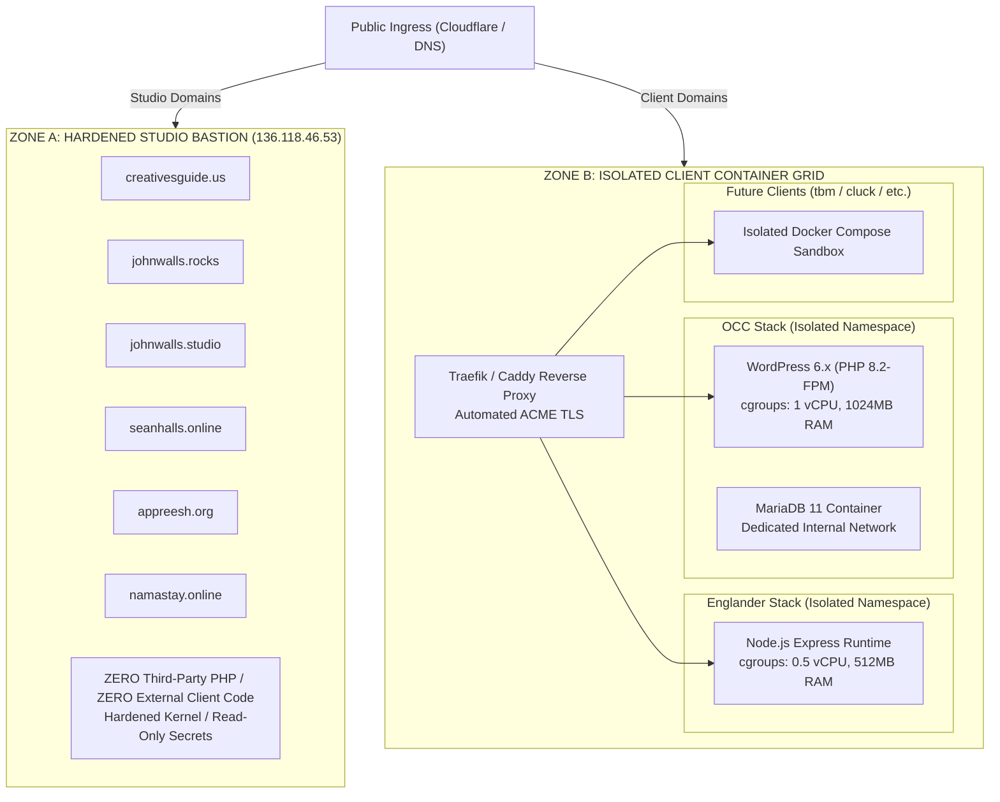

# Infrastructure Isolation Roadmap: Client Workload Migration & Studio Bastion Hardening

**Document Identifier**: `INFRA-ROADMAP-2026-01`  
**Studio Entity**: **seanhalls.online**  
**Author**: Lead Systems Architect  
**Current Host**: `sh-online-clients` (`cgu` / `136.118.46.53`)  
**Target Architecture**: Dual-Zone Isolated Topology (Hardened Studio Bastion + Isolated Client Container Grid)  

---

## Executive Summary: The Imperative for Isolation

Currently, the primary cloud server (`136.118.46.53` / `cgu`) hosts both **first-party Studio IP** and **third-party commercial client applications**:

```
CURRENT VULNERABLE MULTI-TENANT STATE (Single Debian VPS: 136.118.46.53):
┌─────────────────────────────────────────────────────────────────────────────┐
│ Apache 2.4.68 (Shared Reverse Proxy & PHP-FPM)                              │
├──────────────────────────────────────┬──────────────────────────────────────┤
│  STUDIO CORE ASSETS (First-Party IP) │  COMMERCIAL CLIENTS (Third-Party)   │
│  - creativesguide.us (Next.js :3000) │  - occ.consulting (WordPress/PHP)    │
│  - johnwalls.rocks (Next.js :3000)   │  - christianenglander.com (Node :3003)│
│  - johnwalls.studio (Next.js :3000)  │  - future clients (tbm, cluck, etc.) │
│  - seanhalls.online (Static/React)   │                                      │
│  - appreesh.org (Next.js :3002)      │                                      │
│  - namastay.online (Static/Canvas)   │                                      │
├──────────────────────────────────────┴──────────────────────────────────────┤
│  Shared MariaDB 11.8 (career_local 645MB + sh_online_clients)               │
│  Shared Linux Kernel 6.12, Shared Memory (8GB), Shared Disk (25GB NVMe)     │
└─────────────────────────────────────────────────────────────────────────────┘
```

### The Systemic Threat Model:
1. **Security Blast Radius**: WordPress plugins in `occ.consulting` represent an attack surface. A compromised plugin (e.g., arbitrary file upload or SQL injection) yields local `www-data` shell access, placing all Studio files, SSL certificates, environment variables, and Git keys at risk.
2. **Resource Starvation (Noisy Neighbor Syndrome)**: MariaDB query locks or unindexed WooCommerce queries on `career_local` (645 MB) exhaust CPU and memory pools, causing HTTP 502/504 errors on Studio flagship releases (*Creatives Guide Us*, *John Walls*).
3. **IP Reputation & Blacklisting**: A compromised client WordPress site used for outbound spam or phishing risks having `136.118.46.53` blacklisted by Spamhaus, Google Safe Browsing, or major mail providers.
4. **Legal Commingling**: If a client application is subpoenaed or subject to forensic seizure, sharing physical disk volumes with first-party Studio IP introduces severe legal and discovery complications.

---

## 1. The Target Architecture: The Dual-Zone Model



### Architectural Guarantees of the Target State:
1. **Process & Network Isolation**: Every client application runs inside its own Docker container with strict Linux cgroup limits (`cpus`, `memory`, `pids`).
2. **Dedicated Storage & Databases**: Each client receives its own isolated database container. A crash or compromise in OCC's database has zero mathematical possibility of reading or affecting another client or Studio database.
3. **Hardened Bastion (`cgu`)**: `136.118.46.53` is stripped of all PHP runtimes, WordPress files, and external client code. It becomes a fortress dedicated exclusively to Studio Core IP.

---

## 2. Infrastructure Deployment Options for Zone B

| Dimension | Option 1: Dedicated Client VPS Grid (Recommended) | Option 2: Serverless Containerization (Cloud Run) | Option 3: Client-Direct Managed WordPress |
| :--- | :--- | :--- | :--- |
| **Best Suited For** | WordPress, WooCommerce, Node apps, dynamic client portfolios. | Node.js Express APIs, Next.js frontend clients (Englander, Cluck). | Heavy WooCommerce / Content WP sites (OCC Consulting). |
| **Provider** | Hetzner Cloud (CPX21: 3 vCPU, 4GB RAM) or GCP Compute Engine (`e2-medium`). | Google Cloud Run + Serverless VPC Connector + Cloud SQL. | WP Engine, Kinsta, or Cloudways (Client-owned account). |
| **Monthly Cost** | ~$8–$15 / month total (supports 6–10 clients). | Pay-per-request ($0–$5 / month). | $30–$50 / month (Paid directly by Client). |
| **Studio Risk** | **Zero** risk to Studio Core IP; isolated on dedicated IP. | **Zero** server management; automatic sandbox isolation. | **Zero** hosting liability; Studio only bills maintenance. |
| **Migration Effort** | Low (Docker Compose template deployment). | Medium (requires building OCI images & container registry). | Low (WP migration plugin or database import). |

> **STRATEGIC RECOMMENDATION**:  
> - For **Node.js applications** (`christianenglander.com`): Deploy via Docker Compose on the Client Container Grid, or directly to Google Cloud Run.  
> - For **WordPress/PHP applications** (`occ.consulting`): Deploy in an isolated Docker Compose container with its own MariaDB instance, OR transition the client to direct-billed WP Engine hosting during their next contract renewal.

---

## 3. Production Docker Blueprint for Zone B

### 3.1. Master Docker Compose for Client Grid (`docker-compose.yml`)

```yaml
version: "3.8"

networks:
  edge_gateway:
    driver: bridge
  occ_network:
    internal: true
  england_network:
    internal: true

services:
  # --- Edge Reverse Proxy with Automated TLS ---
  traefik:
    image: traefik:v3.1
    restart: always
    command:
      - "--providers.docker=true"
      - "--providers.docker.exposedbydefault=false"
      - "--entrypoints.web.address=:80"
      - "--entrypoints.websecure.address=:443"
      - "--certificatesresolvers.letsencrypt.acme.tlschallenge=true"
      - "--certificatesresolvers.letsencrypt.acme.email=aloha@seanhalls.online"
      - "--certificatesresolvers.letsencrypt.acme.storage=/letsencrypt/acme.json"
    ports:
      - "80:80"
      - "443:443"
    volumes:
      - "/var/run/docker.sock:/var/run/docker.sock:ro"
      - "./letsencrypt:/letsencrypt"
    networks:
      - edge_gateway

  # --- Client 1: OCC Consulting (WordPress + Dedicated MariaDB) ---
  occ_db:
    image: mariadb:11.4
    restart: always
    environment:
      MYSQL_ROOT_PASSWORD: "${OCC_DB_ROOT_PASSWORD}"
      MYSQL_DATABASE: "occ_production"
      MYSQL_USER: "occ_user"
      MYSQL_PASSWORD: "${OCC_DB_PASSWORD}"
    volumes:
      - "occ_db_data:/var/lib/mysql"
    networks:
      - occ_network
    deploy:
      resources:
        limits:
          cpus: "1.0"
          memory: 1024M

  occ_wordpress:
    image: wordpress:6.6-php8.2-apache
    restart: always
    depends_on:
      - occ_db
    environment:
      WORDPRESS_DB_HOST: "occ_db:3306"
      WORDPRESS_DB_NAME: "occ_production"
      WORDPRESS_DB_USER: "occ_user"
      WORDPRESS_DB_PASSWORD: "${OCC_DB_PASSWORD}"
    volumes:
      - "occ_wp_data:/var/www/html/wp-content"
    networks:
      - edge_gateway
      - occ_network
    labels:
      - "traefik.enable=true"
      - "traefik.http.routers.occ.rule=Host(`occ.consulting`) || Host(`www.occ.consulting`)"
      - "traefik.http.routers.occ.entrypoints=websecure"
      - "traefik.http.routers.occ.tls.certresolver=letsencrypt"
    deploy:
      resources:
        limits:
          cpus: "1.0"
          memory: 1024M

  # --- Client 2: Christian Englander (Node.js Express) ---
  england_app:
    build:
      context: ./apps/england
      dockerfile: Dockerfile
    restart: always
    environment:
      PORT: 3000
      NODE_ENV: "production"
    networks:
      - edge_gateway
      - england_network
    labels:
      - "traefik.enable=true"
      - "traefik.http.routers.england.rule=Host(`christianenglander.com`) || Host(`www.christianenglander.com`)"
      - "traefik.http.routers.england.entrypoints=websecure"
      - "traefik.http.routers.england.tls.certresolver=letsencrypt"
    deploy:
      resources:
        limits:
          cpus: "0.5"
          memory: 512M

volumes:
  occ_db_data:
  occ_wp_data:
```

### 3.2. Dockerfile for Node.js Application (`christianenglander.com`)

```dockerfile
# Multi-stage production build for Node.js client runtime
FROM node:20-alpine AS builder
WORKDIR /app
COPY package*.json ./
RUN npm ci --prefer-offline --no-audit
COPY . .

FROM node:20-alpine AS runner
WORKDIR /app
ENV NODE_ENV=production
RUN addgroup --system --gid 1001 nodejs && adduser --system --uid 1001 nodeapp
COPY --from=builder --chown=nodeapp:nodejs /app ./
USER nodeapp
EXPOSE 3000
CMD ["npm", "start"]
```

---

## 4. Five-Phase Migration & Cutover Playbook (Zero-Downtime)

```
[ Phase 0: AUDIT & PREP ]  -->  [ Phase 1: PROVISION ]  -->  [ Phase 2: DATA SYNC ]  -->  [ Phase 3: CUTOVER ]  -->  [ Phase 4: HARDEN ]
Snapshot & TTL Reduction         Boot Container Grid          DB & Media Replication       DNS Switch & ACME TLS      Purge cgu & Bastion Lock
```

### Phase 0: Audit & Preparation (T-minus 48 Hours)
1. **Reduce DNS TTL**: Log into domain registrars (or Cloudflare) for `occ.consulting` and `christianenglander.com`. Reduce `A` record TTL to **300 seconds (5 minutes)**.
2. **Execute Full Pre-Flight Backups**:
   ```bash
   # From local workstation:
   ./scripts/client-offboard.sh --client occ --repo ./clients/ramone_master/occ --db-name career_local --remote-host cgu --cleared
   ./scripts/client-offboard.sh --client england --repo ./clients/neff_master --skip-db --cleared
   ```
3. **Verify Archive Checksums**: Confirm SHA256 hashes for `career_local.sql.gz` and application bundles in `./dist/offboarding/`.

---

### Phase 1: Provisioning the Isolated Client Grid (T-minus 24 Hours)
1. **Spin Up Target VPS**: Deploy a clean Debian 13 or Ubuntu 24.04 instance on Hetzner Cloud or GCP Compute Engine. Assign elastic public IP (e.g., `198.51.100.25`).
2. **Install Docker Engine & Compose**:
   ```bash
   curl -fsSL https://get.docker.com | sh
   sudo usermod -aG docker $USER
   sudo systemctl enable --now docker
   ```
3. **Configure Host Firewall (`ufw`)**:
   ```bash
   sudo ufw default deny incoming
   sudo ufw default allow outgoing
   sudo ufw allow 22/tcp
   sudo ufw allow 80/tcp
   sudo ufw allow 443/tcp
   sudo ufw enable
   ```
4. **Deploy Edge Traefik / Compose Stack**: Deploy `docker-compose.yml` with `acme.json` permissions set to `chmod 600`.

---

### Phase 2: Data Synchronization & Staging Verification (T-minus 6 Hours)
1. **Synchronize WordPress Media & Plugins (`occ.consulting`)**:
   ```bash
   # Rsync directly from cgu to target container host
   rsync -avz -e ssh cgu:/var/www/ramone/wp-content/ target_host:/var/lib/docker/volumes/client_grid_occ_wp_data/_data/
   ```
2. **Restore Database to Isolated MariaDB Container**:
   ```bash
   gunzip < occ_db_career_local_*.sql.gz | docker exec -i client_grid-occ_db-1 mysql -u occ_user -p"$OCC_DB_PASSWORD" occ_production
   ```
3. **Deploy & Build Englander Node Container**:
   ```bash
   git clone git@github.com:YOUR_ORG/englander.git ./apps/england
   docker compose build england_app
   docker compose up -d england_app
   ```
4. **Local Verification via `/etc/hosts` Override**:
   Add to workstation `/etc/hosts`:
   ```text
   198.51.100.25 occ.consulting christianenglander.com
   ```
   Open browser, navigate to both sites, verify login, page rendering, and WooCommerce shopping cart.

---

### Phase 3: Live DNS Cutover & Traffic Migration (T-minus 0)
1. **Place Source WordPress in Read-Only Mode (Brief 5-min maintenance)**:
   ```bash
   ssh cgu "sudo -u www-data wp maintenance-mode activate --path=/var/www/ramone 2>/dev/null || true"
   ```
2. **Final Delta DB Sync**:
   ```bash
   ssh cgu "sudo mysqldump --single-transaction career_local | gzip -9" | gunzip | docker exec -i client_grid-occ_db-1 mysql -u occ_user -p"$OCC_DB_PASSWORD" occ_production
   ```
3. **Update DNS Records**:
   - Change `A` record for `occ.consulting` and `www.occ.consulting` -> `198.51.100.25`.
   - Change `A` record for `christianenglander.com` -> `198.51.100.25`.
4. **Observe ACME Certificate Generation**:
   Tail Traefik logs on the container host:
   ```bash
   docker compose logs -f traefik
   ```
   Certificates will be issued automatically via Let's Encrypt within 60 seconds of DNS resolution.

---

### Phase 4: Studio Bastion (`cgu` / `136.118.46.53`) Hardening & De-commissioning
Once DNS propagation is complete (minimum 2 hours post-cutover):

1. **Disable Apache Client VirtualHosts**:
   ```bash
   ssh cgu
   sudo a2dissite occ.org.conf occ.org-le-ssl.conf
   sudo a2dissite england.conf england-le-ssl.conf
   sudo apache2ctl configtest
   sudo systemctl reload apache2
   ```

2. **Terminate Client Systemd & Process Units**:
   ```bash
   sudo systemctl stop england.service
   sudo systemctl disable england.service
   sudo rm /etc/systemd/system/england.service
   sudo systemctl daemon-reload
   ```

3. **Purge Client MariaDB Database & Users**:
   ```bash
   sudo mysql -e "DROP DATABASE career_local;"
   sudo mysql -e "DROP USER IF EXISTS 'wp_user_ikD7evtN6pYevvU1'@'localhost';"
   sudo mysql -e "FLUSH PRIVILEGES;"
   ```
   *(This immediately frees ~650 MB of MariaDB InnoDB buffer pool space and storage.)*

4. **Archive & Remove Client Files from `/var/www`**:
   ```bash
   # Archive to cold storage before deletion
   sudo tar -czf /home/seanhalls/cold_archives/ramone_occ_archive_$(date +%Y%m%d).tar.gz /var/www/ramone
   sudo tar -czf /home/seanhalls/cold_archives/england_archive_$(date +%Y%m%d).tar.gz /var/www/england
   
   # Delete from live disk
   sudo rm -rf /var/www/ramone
   sudo rm -rf /var/www/england
   ```
   *(This immediately frees ~465 MB of NVMe disk storage.)*

5. **Uninstall PHP-FPM from Studio Bastion (Optional & Recommended)**:
   Since all Studio Core IP applications are pure Node.js (Next.js v16) or static React SPAs, PHP-FPM is no longer required on `cgu`:
   ```bash
   sudo systemctl stop php8.2-fpm
   sudo systemctl disable php8.2-fpm
   sudo apt-get purge -y php8.2*
   sudo apt-get autoremove -y
   ```

6. **Lock Down Apache Modules**:
   Disable unused proxy modules or PHP modules:
   ```bash
   sudo a2dismod proxy_fcgi
   sudo systemctl restart apache2
   ```

---

## 5. Economic & Margin Impact Summary

| Metric | Multi-Tenant Commingled State | Isolated Grid Architecture | Strategic Delta |
| :--- | :--- | :--- | :--- |
| **Studio Server Uptime Risk** | **Critical** (Client bug can crash studio) | **Zero** (Isolated containers / separate VM) | **Eliminated 100% of collateral blast radius** |
| **Studio Hosting Infrastructure Cost** | ~$40 / mo (GCP `e2-standard-2`) | ~$40 / mo (cgu) + $8 / mo (Client Grid) | +$8 / mo overhead |
| **Client Hosting Billing** | Billed inside project ($0–$100 / mo) | Billed at $150–$300 / mo per client | **+$600–$1,200 / mo recurring margin** |
| **Offboarding Complexity** | High (Untangling shared DB & secrets) | Trivial (Isolated container dump via script) | **15 hours saved per client exit** |
| **Audit & Discovery Exposure** | Catastrophic (Client discovery captures Studio IP) | Zero (Air-gapped filesystem) | **100% IP Protection** |

---

## 6. Execution Timeline & Governance

```
WEEK 1: Legal Templates & SOW Integration
  - Attorney reviews STUDIO_TERMS_OF_SERVICE.md and CLIENT_OFFBOARDING_ADDENDUM.md.
  - SOWs updated to incorporate the $1,500 Inbound and $2,500 Outbound packages.

WEEK 2: Client Grid Staging
  - Provision isolated container host (or Cloud Run staging).
  - Test Docker Compose stack with sample WordPress and Node.js workloads.

WEEK 3: Cutover of Englander & OCC
  - Lower TTLs to 300s.
  - Execute Phase 2 (data sync) and Phase 3 (DNS flip).
  - Verify SSL and mobile rendering.

WEEK 4: Bastion Hardening on cgu
  - Execute Phase 4 decommissioning on 136.118.46.53.
  - Purge career_local, remove /var/www/ramone and /var/www/england.
  - Purge PHP-FPM, lock down MariaDB, and verify pure Studio IP operation.
```

---
*Roadmap established by seanhalls.online Architecture Office.*
